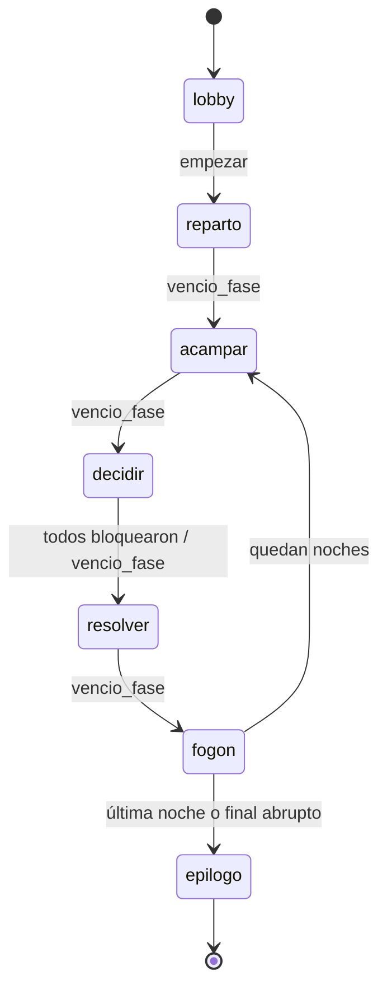

# 02 · Máquina de estados

Referencia: `juegos/travesia/core/src/maquina.ts`.

## La firma

```ts
reducir(estado, comando) → { estado, efectos } | rechazo
```

Función pura. No abre sockets, no llama al modelo, no mira `Date.now()`. Todo lo
que el mundo exterior tiene que hacer sale como `Efecto` y lo ejecuta el servidor.

Esto es lo que permite jugar una travesía entera en una terminal, que es el
criterio de salida del hito M1: **si el loop de una noche no es interesante sin UI,
no lo va a salvar ninguna animación.**

## Fases



| Fase | Dura | Qué pasa |
|---|---|---|
| `lobby` | lo que tarden | Entran celulares, se vota tablero, se marcan listos |
| `reparto` | ~15 s | Se asignan roles y objetivos. Cada celular recibe lo suyo |
| `acampar` | 20 s | La TV muestra el estado del grupo. Los roles reciben su revelación |
| `decidir` | 180 s × factor | Se discute en voz alta y se bloquea en secreto. La fogata es el reloj |
| `resolver` | 7 s | Única cutscene de la noche. Se dispara el pedido al modelo (`D6`) |
| `fogon` | 30 s | El camino hace la pregunta incómoda. Le pasa el micrófono al grupo |
| `epilogo` | lo que tarden | Se revelan objetivos, el trato y la crónica |

La ventana de `decidir` se acorta con la noche: ×1 en las noches 1–2, ×0.75 en las
3–4, ×0.6 en la 5 (`ventanaDecidirMs`). El grupo no lo lee en ningún lado: lo
siente porque el fuego dura menos (`D3`).

## Comandos por fase

Un comando fuera de su fase se **rechaza**, no se encola. Encolar produce el peor
bug posible en un juego de mesa: algo que se aplica una ronda tarde y nadie entiende.

| Comando | Fases donde vale |
|---|---|
| `crear` | — (crea la partida) |
| `sumar_jugador`, `quitar_jugador`, `marcar_listo` | `lobby` |
| `empezar` | `lobby`, con 2 a 10 jugadores y todos listos |
| `elegir` | `decidir`, y sólo si el jugador todavía no bloqueó |
| `bloquear` | `decidir` |
| `responder_trato` | `acampar`, `decidir`, y sólo el destinatario |
| `entregar_objeto` | `acampar`, `fogon` |
| `vencio_fase` | cualquiera con reloj |
| `relato_listo` | `resolver`, `fogon`, `epilogo` |

## Efectos

| Efecto | Quién lo ejecuta | Cuándo |
|---|---|---|
| `agendar { enMs }` | El servidor pone un `setTimeout` que manda `vencio_fase` | Al entrar a toda fase con reloj |
| `pedir_relato { pedido }` | La capa LLM, sin bloquear | Al **entrar** a `resolver` (`D6`) |
| `publicar { a }` | El servidor proyecta vistas y las manda | Después de todo comando aceptado |
| `terminar` | El servidor cierra la sala | Al salir del `epilogo` |

Un solo `agendar` vivo por partida. Al aplicar cualquier transición de fase, el
servidor cancela el timer anterior antes de armar el nuevo: dos timers pisándose
adelantan una noche y no hay forma de darse cuenta mirando la TV.

## Las dos carreras que importan

**El relato llega tarde.** La cutscene dura 7 segundos y el modelo tiene 5,5 de
presupuesto. Si `relato_listo` no llegó cuando vence `resolver`, la fase avanza
igual con el respaldo del tablero, y un `relato_listo` posterior **se descarta**:
llegó tarde, la mesa ya siguió.

**Todos bloquean antes de que venza el tiempo.** `decidir` termina por lo que pase
primero. Si el último jugador bloquea con 40 segundos de fuego por delante, la
noche resuelve ya: hacer esperar a cinco personas que ya decidieron es la forma más
rápida de que alguien saque el teléfono.

## Reconexión

No hay resincronización parcial ni parches (`D4`). Cuando un cliente vuelve:

1. Se reasocia el socket al asiento por token de sesión.
2. Se proyecta la vista completa y se manda.
3. Se repinta.

La TV que vuelve en el medio de una cutscene **no la reproduce**: aparece en el
estado posterior. Una animación a destiempo es peor que ninguna animación.

## Final abrupto

La travesía puede terminar antes de la última noche si `recurso = 0` y todos los
viajeros están quebrados. No hay "game over": se salta al `epilogo` y la crónica lo
cuenta. El juego no tiene pantalla de derrota porque el producto es la anécdota,
y una anécdota de fracaso sirve igual.
